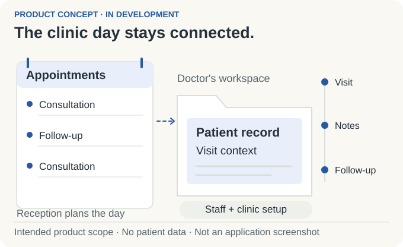

# Doctoleb

## A clinic's working day, brought together.

I'm building a clinic-management application that brings **appointments, patient records, and visit administration** into one place. It is designed around the connected work of receptionists, doctors, and clinic administrators.

*Personal project · In development · Application source private*

<picture>
  <source media="(prefers-color-scheme: dark) and (max-width: 520px)" srcset="assets/clinic-story-v2-mobile-dark.svg">
  <source media="(max-width: 520px)" srcset="assets/clinic-story-v2-mobile-light.svg">
  <source media="(prefers-color-scheme: dark)" srcset="assets/clinic-story-v2-dark.svg">
  
</picture>

*Concept illustration of intended scope, not an application screenshot.*

### What I'm designing around

- **One connected working day.** Reception handles appointments and daily administration; doctors need relevant records and visit context; administrators configure the clinic and staff responsibilities.
- **The languages a clinic uses.** English, Arabic, and French interfaces, with Arabic layouts designed for right-to-left reading.
- **Connectivity that varies.** Local browser storage sits at the center of the product direction, with synchronization and server coordination under development.

### My contribution

I translate clinic workflows into product requirements, design interfaces across languages, and work on local operation and synchronization boundaries. Role-specific data visibility is part of the product direction.

---

<strong>Engineering details: architecture, local storage, and synchronization</strong>

### Application approach

| Area | Approach and current boundary |
| --- | --- |
| Application | React and TypeScript progressive web application; under development, with private source. |
| Local persistence | IndexedDB for browser-resident data; part of the local-first approach. |
| Synchronization | Node-based server coordination; design and development work, with no completed multi-device rollout claimed here. |
| Language and layout | English, Arabic, and French; right-to-left Arabic layouts are part of the product scope. |
| Staff visibility | Receptionists, doctors, and administrators have different responsibilities; application and server boundaries need to reflect them. |

### The engineering questions

A locally accepted change and a server-confirmed change are different states. The design needs to make those states understandable while addressing retries, duplicate submissions, concurrent edits, conflicts, device access, and recovery.

<picture>
  <source media="(prefers-color-scheme: dark)" srcset="https://raw.githubusercontent.com/MahdiHajjHassan/doctoleb-showcase/main/assets/local-first-dark.svg">
  
</picture>

The existing diagram illustrates the architecture direction. It does not establish verified production behavior.

### Read further

- [Architecture and development status](https://github.com/MahdiHajjHassan/doctoleb-showcase/blob/main/docs/architecture.md)
- [Clinic workflows](https://github.com/MahdiHajjHassan/doctoleb-showcase/blob/main/docs/workflows.md)

This public showcase contains no patient records and does not claim a production rollout, clinical certification, or executed implementation checks.

[Mahdi Hajj Hassan](https://github.com/MahdiHajjHassan)
