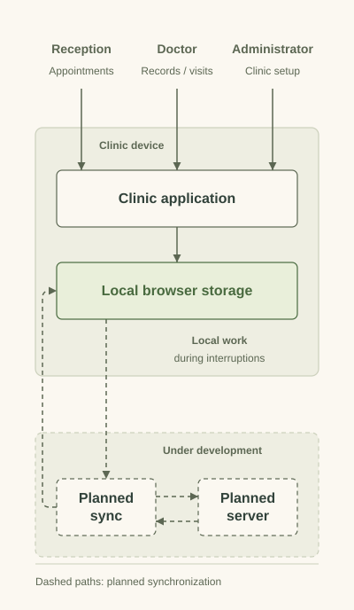

# Doctoleb

I'm developing a clinic-management application that brings appointments, patient records, and visit administration into one place. It is designed for doctors, receptionists, and administrators, with English, Arabic, and French interfaces.

The application is a personal project in development. This repository explains its product direction and architecture; the application source is private.

## Clinic work with local storage

<picture>
  <source media="(prefers-color-scheme: dark)" srcset="assets/local-first-dark.svg">
  
</picture>

The local-first approach puts browser storage at the center of day-to-day work. Staff have different responsibilities, and connectivity should not dictate every interaction. The dashed path represents synchronization under development, rather than a completed multi-device rollout.

## My focus

I translate clinic workflows into product requirements, design interfaces across languages, and work on local operation and synchronization boundaries. Role-specific data visibility is part of the product direction.

## Technical detail

- [Architecture and development status](docs/architecture.md): the React and TypeScript application, local persistence, and synchronization design.
- [Clinic workflows](docs/workflows.md): reception, doctor, and administrator responsibilities.

This showcase contains no patient records and does not claim a production rollout or clinical certification.

[Mahdi Hajj Hassan](https://github.com/MahdiHajjHassan) · [My independent AI workflow](https://github.com/MahdiHajjHassan/ai-development-workflow)
