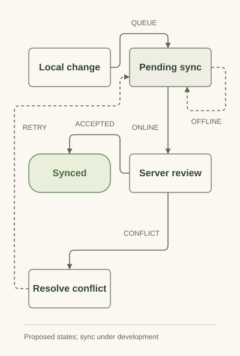

# Architecture and development status

Doctoleb is a personal project in development. This is an architectural overview, not source or deployment instructions. Describing a component does not establish that its production behavior has been verified.

## Components

| Component | Approach | Status boundary |
| --- | --- | --- |
| Browser application | React and TypeScript progressive web application | Under development; source is private |
| Local persistence | IndexedDB for browser-resident data | Part of the local-first approach; no stored records included here |
| Validation | Shared validation for application data | Engineering approach; no executed suite included here |
| Synchronization | Node-based server coordination | Design and development direction; no completed multi-device deployment claimed |
| Languages | English, Arabic, and French, with right-to-left Arabic layouts | Product scope; not a completeness claim for every screen |

## Local operation and synchronization

Local persistence is intended to support clinic workflows when connectivity is unreliable. A locally accepted change and a server-confirmed change are different states.

Implementation must address retries, duplicate submissions, concurrent edits, conflicts, device access, and data recovery. These are engineering responsibilities rather than capabilities demonstrated by this documentation.

<picture>
  <source media="(prefers-color-scheme: dark)" srcset="../assets/sync-states-dark.svg">
  
</picture>

This illustrates proposed synchronization states, not a completed protocol or conflict-resolution implementation.

## Visibility and verification

Receptionists, doctors, and administrators have different responsibilities. Data visibility needs to reflect those responsibilities at application and server boundaries; interface controls alone do not establish authorization.

Unit, integration, and end-to-end checks are part of the development plan. This repository does not publish their results, a security assessment, clinical outcomes, or certification. All public descriptions avoid patient information.

[Project overview](../README.md) · [Clinic workflows](workflows.md)
