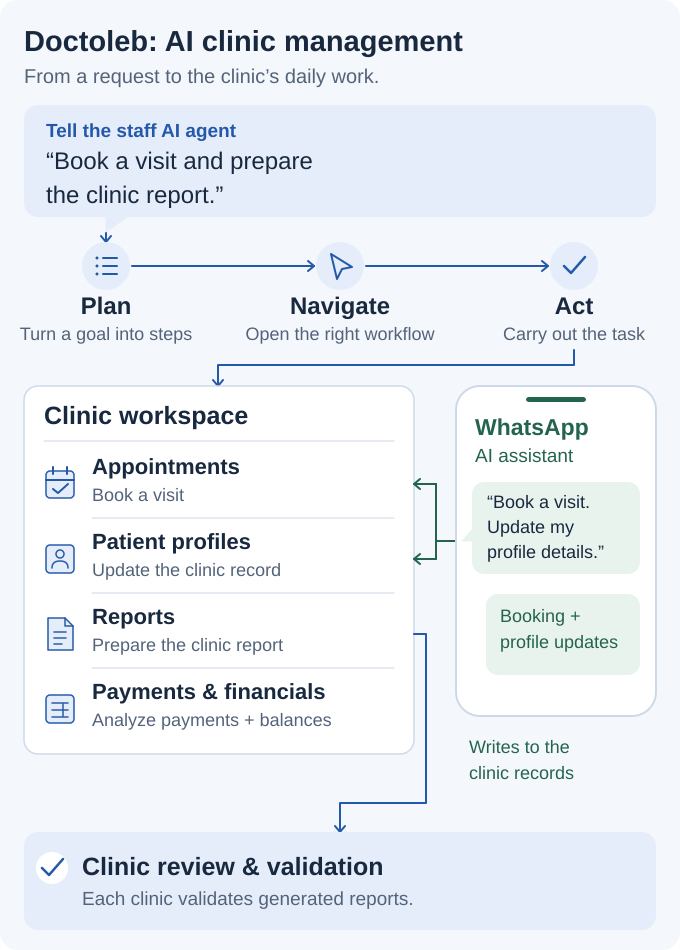

# Doctoleb | AI Clinic Application Architecture

> [!CAUTION]
> **Private clinic application.** Doctoleb is in development and its application source is private. This page explains the product and architecture through diagrams; it contains no patient records or deployment, clinical certification, or application test results.

Doctoleb connects conversational AI with appointments, patient records, reports and clinic financials. The React and TypeScript application, local storage, and server coordination support these shared clinic workflows.

## Two ways to work through AI

Staff give the AI agent a goal in chat. The agent plans the task, navigates the application and interacts with its workflows. Patients use a WhatsApp AI assistant to book appointments and update their profiles. Both routes connect to the same clinic platform.

<picture>
  <source media="(prefers-color-scheme: dark) and (max-width: 520px)" srcset="../assets/clinic-story-v6-mobile-dark.svg">
  <source media="(max-width: 520px)" srcset="../assets/clinic-story-v6-mobile-light.svg">
  <source media="(prefers-color-scheme: dark)" srcset="../assets/clinic-story-v6-dark.svg">
  
</picture>

## Components

| Component | Responsibility |
| --- | --- |
| Staff AI agent | Interpret a goal, plan the task, navigate the application and carry out clinic workflows. |
| WhatsApp AI assistant | Connect patient conversations to booking and profile updates in the clinic platform. |
| Reporting workflow | Generate reports for review and validation by each clinic. |
| Payment and financial analysis | Analyze clinic payment and financial information. |
| React and TypeScript progressive web application | Staff workflows in the browser. |
| IndexedDB | Local application data for interrupted connectivity. |
| Shared validation | Consistent application data formats. |
| Node-based synchronization | Pending changes, retries, server acceptance, and conflicts. |
| Multilingual interface | English, Arabic, and French, including right-to-left Arabic layouts. |

## Local changes and server confirmation

I designed the application to distinguish a saved local change from one accepted by the server. Synchronization accounts for retries, duplicate submissions, concurrent edits, conflicts, device access, and recovery.

<picture>
  <source media="(prefers-color-scheme: dark)" srcset="https://raw.githubusercontent.com/MahdiHajjHassan/doctoleb-showcase/main/assets/sync-states-dark.svg">
  
</picture>

## Staff access

Receptionists manage appointments and administration; doctors need patient and visit context; administrators manage clinic configuration and staff responsibilities. I defined visibility around those tasks.

Authorization applies to application data and server requests, as well as the controls displayed on screen.

[Project overview](https://github.com/MahdiHajjHassan/doctoleb-showcase/blob/main/README.md) · [Clinic workflows](https://github.com/MahdiHajjHassan/doctoleb-showcase/blob/main/docs/workflows.md)
